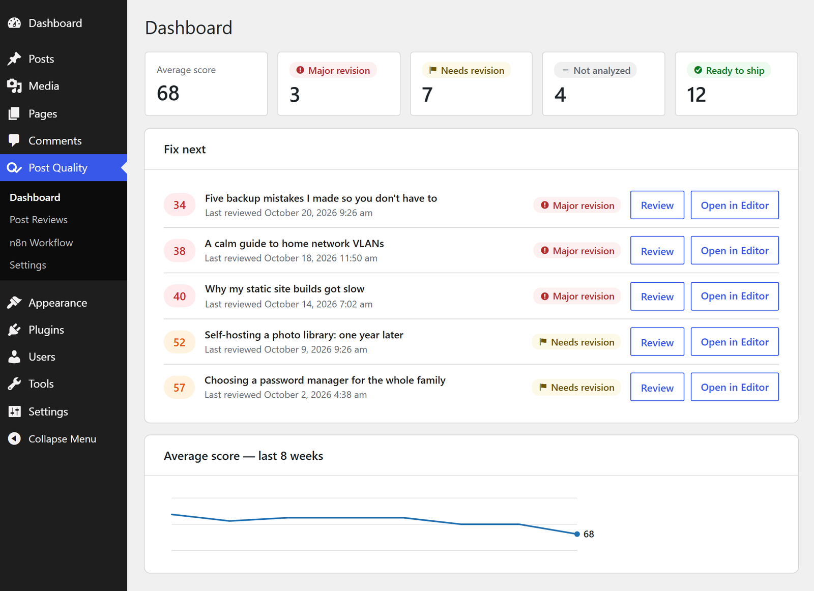
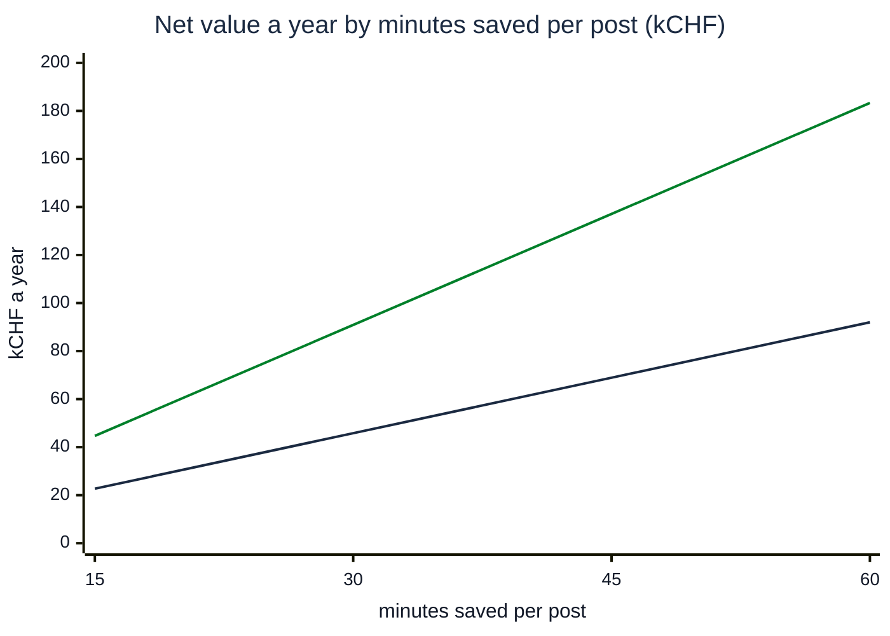
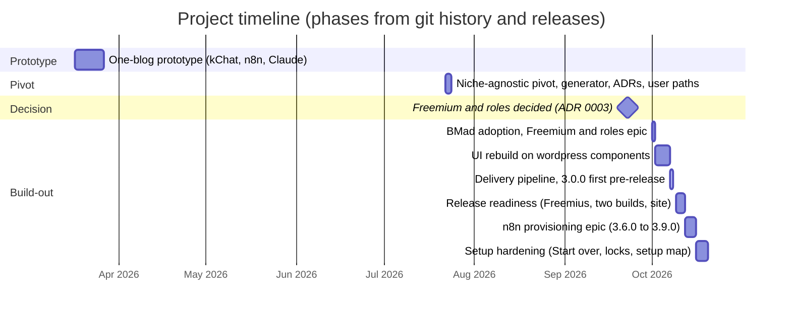
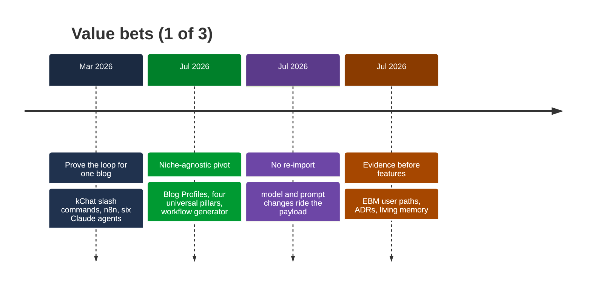
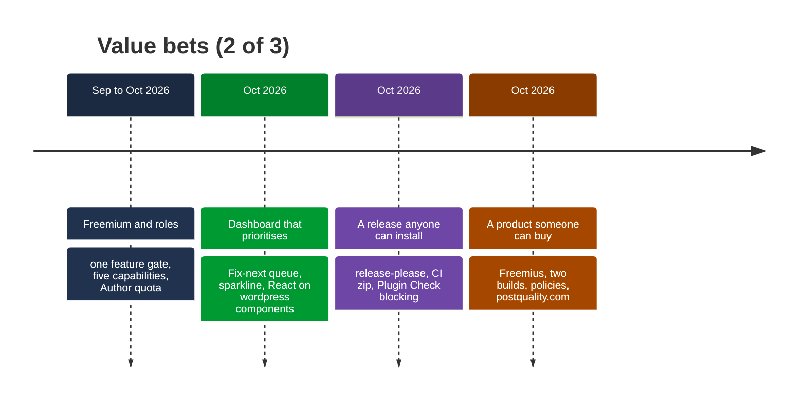
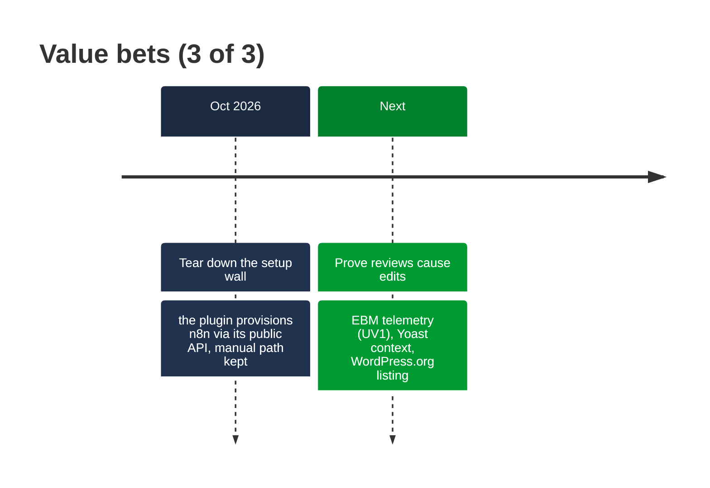
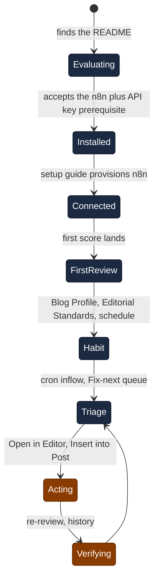
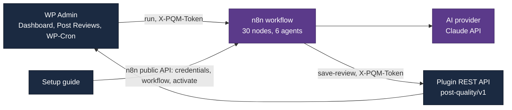

# Product Owner & Solo Builder Portfolio — Post Quality Manager

_Case study: taking a one-blog automation prototype to a sellable, niche-agnostic WordPress product with an AI-agent delivery loop, in 22 active working days._

_Last updated: 2026-10-20_

*The Dashboard after the UI rebuild (October 2026): the "Fix next" queue is the product's answer to "which posts need editorial attention, and why".*

## How to read this document

Every figure here comes from the repository: git history, the 15 Architecture Decision Records in `docs/adr/`, the EBM user-path analysis in `docs/user-paths.md`, the BMad ticket tree in `_bmad-output/` and the CI configuration. Nothing is modelled except two labelled estimates: the team-effort estimate in section "Solo delivery, team-sized output", detailed in the appendix, and the consultant-time model in section "Time and money returned to the authors", whose every input is listed in its assumptions table. Where a number does not exist yet (the product has no public users), the text says so with a `‹FILL: …›` placeholder instead of guessing.

## At a glance

| | |
|---|---|
| **Role** | Product Owner and sole builder (Vincent Heimann); product, architecture, delivery process, commercial setup |
| **Product** | Post Quality Manager: a WordPress plugin that scores every post on four editorial pillars through the blogger's own n8n workflow and AI provider, stores the history and shows where to act next |
| **Timeline** | First commit 2026-03-17; niche-agnostic pivot 2026-07-22; first release 3.0.0 on 2026-10-08; 3.9.0 on 2026-10-15; setup hardening to 2026-10-20 (pre-release until public launch) |
| **Delivery** | 362 commits on 24 active days; 156 pull requests, rebase-merged; 13 tagged releases in 8 days (v3.0.0–v3.9.0), each with a CI-built zip |
| **Business model** | Free build (Review + Key Takeaways) for the WordPress.org directory; Pro per site, yearly, sold through Freemius before the first public release (ADR 0013/0014) |
| **Stack** | PHP 8 WordPress plugin (REST API, WP-Cron, custom table), React admin app on `@wordpress/components`, n8n workflow template (30 nodes, 6 agents), Claude API; GitHub Actions, release-please, Plugin Check |
| **Method** | BMad Method (lightweight) since 2026-10-01: spec → ticket → build (plan checkpoint, parallel reviewers) → retrospective; ADRs for the why, versioned memory for the what |
| **Proof** | 139 JS unit tests, 17 PHP harnesses run in CI, Plugin Check blocking, owner-verified manual passes on eleven documented dates; no external users yet |

## Time and money returned to the authors

Post Quality Manager is blog-agnostic: any WordPress site can run it with its own n8n and AI provider. It is about to be submitted to the WordPress plugin directory and has a dedicated website, [postquality.com](https://postquality.com). The blog it was first built for belongs to dbi services, the Swiss consulting company where the owner works. Its posts are written by the consultants themselves: 55 active authors, one to two posts a month each. Nothing leaves the firm's hands: posts travel through dbi's own n8n and its own AI provider account, with no third-party service in between.

For a consulting firm, the cost of a blog post is consultant time not billed to a customer. At dbi services that hour is billed at CHF 140. The plugin gives part of that time back, and this section sizes it, assuming the returned hour goes to a customer. The figures about the firm and the minutes saved are the owner's; the running costs are assumptions. All of them are in the [assumptions table](#assumptions-behind-the-time-model). Amounts exclude VAT.

**≈ 330–990 consultant hours a year back on billable work, worth ≈ CHF 46k–137k net a year (≈ CHF 3.8k–11.4k a month).**

The arithmetic in one line: 55 authors × 1–2 posts a month × 30–45 minutes × CHF 140 an hour, less CHF 0.4k–1.5k a year of running costs.

### How the time comes back

Without the plugin, a consultant who wants a post to meet the bar reviews it against the editorial standards, rewrites the weak paragraphs, writes the takeaways, the sources list and the SEO title and description. The six agents do this in one click. Many consultants skip part of that work today, so the estimate counts only what is actually saved, net of reading and applying the review: **30–45 minutes per post**. In the mid scenario that adds up to about 52 hours a month across the firm, roughly a third of one consultant's billable month.

### Three scenarios

| Scenario | Posts a month | Minutes saved per post | Hours a month | Hours a year | Net value a month | Net value a year | Per consultant a year |
|---|---|---|---|---|---|---|---|
| Low | 55 (1 per consultant) | 30 | 28 | 330 | ≈ CHF 3.8k | ≈ CHF 46k | 6 h, ≈ CHF 840 |
| Mid | 83 (1.5 per consultant) | 37.5 | 52 | 619 | ≈ CHF 7.1k | ≈ CHF 86k | 11 h, ≈ CHF 1,575 |
| High | 110 (2 per consultant) | 45 | 83 | 990 | ≈ CHF 11.4k | ≈ CHF 137k | 18 h, ≈ CHF 2,520 |

**Running costs**, already netted above, stay under four per cent of the value: the licence (CHF 49 a year, ADR 0013), an n8n instance (CHF 240–600 a year) and the AI provider (CHF 0.20–0.60 per post, CHF 130–790 a year).

**Sensitivity.** The minutes saved per post is the one input nobody has measured yet, and it moves the result most: 15 minutes more or less is CHF 23k–46k a year. The chart shows how the yearly value responds to it, for one and for two posts a month; the owner's 30–45 minute range is the middle of the axis.

*Green: two posts a month per consultant. Dark: one post a month. Even at 15 minutes per post, the low end returns CHF 23k a year; at 60 minutes and two posts, CHF 183k.*

**How to verify it in a month.** Ten consultants run the plugin on every post for one month. Two questions after each reviewed post, minutes the review saved and minutes it cost, replace the estimate with a measured figure. The share of reviewed posts edited within 14 days, computed from the plugin's own data without tracking, shows whether reviews change anything at all; that signal is the EBM map's first validation bet.

**Not counted.** Better posts bringing leads and candidates, the marketing team's review time, the onboarding hour per consultant, and posts that would not have been written at all. Probably worth more than the minutes, but not sizeable yet.

### Assumptions behind the time model

| Input | Value used | Source |
|---|---|---|
| Firm | dbi services, Swiss consulting company; the owner's employer | Owner input |
| Active authors | 55 consultants | Owner input |
| Posts per author per month | 1–2 | Owner input |
| Value of an author hour | CHF 140, the rate billed to customers | Owner input |
| Time saved per post | 30–45 min, net of reading and applying the review | Owner input, see Sensitivity |
| Billable month of a consultant | ≈ 160 h | Assumption, used only for the "a third of a billable month" comparison |
| Plugin licence | CHF 49 per site per year | ADR 0013 (D5, CHF offered at the same figures) |
| n8n instance | CHF 20–50 a month | Assumption: cloud starter plan or a small VPS |
| AI provider | CHF 0.20–0.60 per post for six agents | Derived from the plugin's model registry (USD 3 / 15 per million input / output tokens for the default model), the template's prompt sizes and 1,000–2,000 output tokens per agent |
| Exchange rate | CHF and USD treated at parity | Simplification; the error is below the rounding of the ranges |

## Competencies covered

- **Value-driven prioritisation:** one Evidence-Based Management map (Current vs Unrealized Value per journey stage) is the single requirement source; every `/prioritize` sitting is recorded with its reasoning.
- **Decision hygiene:** 15 ADRs in seven months, each with the alternatives that lost; two of them supersede earlier ones instead of rewriting them.
- **Product-to-market work:** naming (slug as a one-way door), brand and copy rules, WordPress.org guideline compliance, licensing provider, pricing, policies, a public home.
- **Full-stack WordPress delivery:** PHP REST contract, capability model, React admin screens, n8n provisioning through its public API, release automation.
- **Running an AI-agent delivery loop under control:** spec-before-code, plan checkpoints, independent review lenses, automated gates, honest accounting of what the agents wrote.

## Solo delivery, team-sized output

**≈ 98–145 team person-days of modelled effort — delivered by one person in ≈ 24 active working days.**

Leverage of at least **4×**, stated as a floor: active days (days with one or more commits) are an upper bound on the full-time-equivalent effort behind them. How the team figure is built is in the [appendix](#appendix-how-the-team-effort-estimate-is-built).

| | Solo (measured) | Conventional team (modelled) |
|---|---|---|
| **People** | 1 | 6–8 roles across 8 workstreams |
| **Effort** | 24 active days, 2026-03-17 → 2026-10-20, 362 commits; plus eleven dated owner sittings outside git (manual passes on a live site, Freemius / domain / DNS setup, the n8n spike instance), ‹FILL: hours per sitting› | 98–145 person-days |
| **Scope** | Identical by construction: what this repository contains, nothing more | |

Measured side, from git only: 40 commits in March 2026 (prototype), 21 in July (pivot), 2 in September (decision), 299 in October (build-out). The owner sittings are the dates on which `memory/` and the ticket tree record an owner-verified manual pass, walk or production test (2026-07-22/23/24, 10-01/02/06/07/08/12/14/15); their duration is not recorded, so it is left to the owner to fill rather than estimated.

## Decision-making

Decisions are framed by what was at stake; product and business calls first, technical foundations after. Each links to its ADR.

| Decision | Value at stake | Alternatives rejected | Record |
|---|---|---|---|
| Pivot from one blog's tooling to a niche-agnostic plugin with a workflow generator (2026-07-22) | Addressable market: every professional blog instead of one | Keep the site-specific workflow; a wizard-style workflow builder | `memory/pivot-agnostic.md`, ADR 0001 context |
| Prioritise by an EBM user-path map, not a persona deck or a full four-KVA scorecard (2026-07-24) | Effort goes to the largest unrealized value; ceremony kept proportional to a solo project | Personas; full EBM scorecard | ADR 0002 |
| Freemium plan and role-based access through **one feature gate** (2026-09-22) | A free tier that acquires, a paid tier that funds; cost control per author | Separate builds, home-grown licensing, trimmed free template | ADR 0003 |
| Sell Pro through Freemius, yearly per site, **before** the first public release (2026-10-09) | No release that hands Pro to anyone typing a word in a field; a merchant of record for VAT | Lemon Squeezy / Paddle; own shop on EDD or WooCommerce; "Pro is coming" relabel | ADR 0013 |
| Two builds from one source: Free for the directory, Pro served by Freemius (2026-10-09) | WordPress.org guideline 5 forbids locked code in directory plugins; the directory is where users come from | A separate Pro add-on plugin; staying off the directory | ADR 0014 |
| The plugin provisions n8n itself through n8n's public API (2026-10-12) | Setup is the activation wall (user-paths stage A4); seven manual steps become three fields | Manual path only; partial provisioning; secrets in each run payload | ADR 0015 |
| Name: Post Quality Manager, slug `post-quality-manager`, provider-neutral tagline (2026-10-08) | The slug can never change after directory approval | "Content Quality" (retired); provider names in the tagline | `docs/brand.md` § Naming |
| Retire "View as", replace with a Roles tab that *sets* rights (2026-10-08) | An Administrator needs to configure, not simulate; simulation left no way back | Fix and keep the toolbar switch; both | ADR 0012 |
| Adopt the BMad Method, lightweight (2026-10-01) | A delivery loop with plans, reviews and retrospectives instead of a prose backlog | Hand-rolled process; the owner's own scaffold; full BMad with PM/Architect agents | ADR 0004 |
| Rebuild the two app-like screens on `@wordpress/components` (2026-10-02) | Remove a double render source (PHP + 500 lines of string-built JS) that was already drifting | Vanilla JS; Alpine/htmx; Vue/Svelte | ADR 0005 |
| One webhook token authenticates both directions, in a header (2026-10-07) | Close an unauthenticated trigger that could spend the owner's API credit | A second inbound token; a check inside a Code node | ADR 0010 |
| Two voice layers: Editorial Standards per site, a voice per author (2026-10-07) | Every post checked in its author's voice under shared rules; serves solo, team and company | One site voice; a voice per post; admin-edited author voices | ADR 0011 |
| Multi-provider models through two request shapes under one monthly token limit (2026-10-06, not yet built) | Free models and cost control without routing every call through a middleman | One shape per provider; OpenRouter for everything | ADR 0009 |
| Decline two agent-tooling plugins after reading their source; keep one machine-local (2026-10-05) | Reviewer bias and unpinned hooks avoided; a 3 % token saving not worth a 1,000-token prompt | Install all three | ADR 0007 |

Undocumented territory: the March 2026 prototype predates the ADR practice; its choices (kChat as the entry point, Claude as the only model) are visible in history but were never recorded as decisions. The pivot itself is held in `memory/`, not an ADR, by the rule in ADR 0001 that past decisions are backfilled only when revisited.

## Value identification & prioritization

The project ran in three bursts with long pauses between them, and the pauses were spent deciding, not building.

The bets below are the sequence of "what is the largest unrealized value now" answers. Each block holds at most four.

**What was built when, and why.** The March prototype answered one question only: can an n8n workflow with Claude agents score and rewrite posts well enough to be useful? It could, for one blog, driven from a chat tool. The July pivot made the answer general (Blog Profiles and editable prompts carry the niche, not code) and removed the largest maintenance cost the prototype had exposed: every model or prompt change meant re-importing the workflow. The same three days set up the decision records and the EBM map, so that the next burst would start from ranked value, not from a feature list. September's single decision (freemium and roles) was taken in writing before any code. October then ran as epics in the order the map gave: the gate first (it blocks the directory), the screens the gate shows, a release path, the commercial layer that a release needs, and the setup wall that stands between an evaluator and the first review.

**What was deliberately not built.** A graph-based workflow builder (a config-injected template does the job); a custom chat client (the webhook contract is the boundary); a rewrite-centred habit (the owner's own usage showed rewrite is not part of the loop); multisite; a full EBM scorecard; BMad's PRD and architecture agent layer; an Astro marketing site (filed, then parked until real buyers exist); two of three agent-tooling plugins; a "View as" simulation (built, measured against the real need, retired within a day). Three more things were consciously postponed and are the next bets: telemetry for the insight-to-action loop, the Yoast snapshot per review, and the WordPress.org listing.

## User-path design

`docs/user-paths.md` maps two journeys for one persona (a professional blogger in any niche): the new user from problem to habit, and the existing user's quality loop. Each stage carries its Current Value, its Unrealized Value and a candidate signal. The product's critical moment is the first stored review: everything before it is cost, everything after is value.

Dark states are owner-verified Current Value; the two orange states are where the map says the product's core promise is still unproven: nothing yet measures whether a review leads to an edit, or tells the blogger that the blog's average moved. That gap ranks first in the map and is the next epic.

How the pieces talk to each other:

## Technical range

| Area | What shipped | Evidence |
|---|---|---|
| WordPress plugin core (PHP 8, 4.4k lines in `includes/`) | Nine REST routes under `post-quality/v1`; custom review table with history; WP-Cron batches with frequency, batch size, minimum score and post age; five `pqm_*` capabilities with a versioned default map; one feature gate combining plan and capability; per-user monthly quota; block insertion through core's parser and serialiser | `class-pqm-rest-api.php`, `class-pqm-features.php`, `class-pqm-blocks.php`, ADR 0003/0008 |
| Admin app (React, 7k lines in `src/`) | Dashboard with Fix-next queue and 8-week sparkline; Post Reviews with filters, sort, detail panel, bulk run and polling; a setup guide that connects n8n by key, provisions it, runs the first review and continues into profile, standards and schedule; Settings tabs incl. a Roles tab | ADR 0005/0012, `src/kit/`, stories 5.1–5.9, 36, 55, 42 |
| n8n integration | A 30-node template filled from settings with placeholders; version handshake on every ping; token-authenticated trigger (Header Auth) and callback; per-site webhook path so several sites share one instance; server-side provisioning through the n8n public API with rollback and adoption of hand-made setups; read-only mis-wiring diagnosis | ADR 0010/0015, workflow v6, `class-pqm-n8n.php` |
| AI integration | Model registry with payload-driven request parameters (effort, temperature only where supported); six agents (review, rewrite, takeaways, sources, SEO, audit); Blog Profiles and Editorial Standards presets with Custom; author voice from the WordPress profile | ADR 0009/0011, `memory/llm-options-architecture.md` |
| Delivery and release | GitHub Actions CI: JS lint and 139 unit tests, PHP lint on 8.0 and 8.3, 17 harnesses, Plugin Check on the built plugin and on the Free build; release-please on Conventional Commits with rebase-only merging; CI-built zip attached to every release; a Free build generated from `__premium_only` markers and diffed against the shipped one | `.github/workflows/`, `tests/harness/`, ADR 0014 |
| Commercial and compliance | Freemius SDK integration behind one `PQM_License` class; pricing and plans decided by spike; privacy, terms, refund, support and security policies; a distribution data sheet listing every field WordPress.org, Freemius, GitHub and the site ask for; a secret scan of the whole history with rotation of what it found | ADR 0006/0013, `docs/policies/`, `docs/distribution.md`, entry 4.9 |
| Product documentation | README with the problem statement and the REST contract; brand and naming rules; user paths; 15 ADRs; a versioned memory folder with a lessons log (18 rules); ≈16,500 words of docs | `docs/`, `memory/` |

**Engineering discipline.** KISS and a minimal-code ladder (YAGNI → reuse → stdlib → platform) are persistent build facts; every ticket cites its ADR instead of restating it; a Definition of Done requires `php -l` on every touched file, a release-notes line for any change an existing site meets silently, and a plan checkpoint before implementation. Secrets never ship in the template: a harness fails CI if the template names a literal host, an IP or a placeholder outside the allowed list.

**Secondary deliverables.** The n8n workflow template and its Free variant; a Mermaid diagram of the workflow; a `npm run zip` local packager; de_DE test fixtures proving the translation path; the BMad customisation layer (`_bmad/custom/`) and three project skills (`/prioritize`, `/adr`, `/release`).

### Staying in control of AI agents

The code is largely agent-written and the record says so: 221 of the 298 commits since the July pivot carry a Claude co-author trailer; the 40 March commits (the prototype, including its `wip:` trail) are the owner's own hand. Since the pivot the owner's contribution is the part a Product Owner is paid for: deciding what to build and why, specifying it, reviewing what came back, and testing it on a real site. What keeps that honest:

- **Spec before code.** Larger work goes through `bmad-spec` (a kernel plus capability files) and `bmad-ticket`; nothing is implemented from a chat message alone.
- **A plan checkpoint.** Every `bmad-build` writes a plan the owner approves before the implementer runs; the plan is kept next to the ticket.
- **Independent review.** Parallel review lenses (adversarial, edge cases, verification gaps, overbuild) run on each change; findings are triaged, not auto-applied. Two external agent plugins were declined precisely because their hooks would have biased those reviewers (ADR 0007).
- **Automated gates.** CI, Plugin Check blocking on errors, harnesses for the capability map, sanitising, licensing, templates and release headers.
- **Owner-verified passes.** Each epic ends with a manual walk on a live site before it is marked done; the dates are in the ticket tree.
- **A lessons loop.** Agent mistakes become rules in `memory/lessons.md` (18 so far) that load into every build.
- **Scope discipline.** The ticket tree holds a `deferred-work.md`; "View as" was retired a day after shipping when the real need turned out to be configuration, not simulation.

## Launch & validation strategy

The product is pre-launch: 13 pre-releases exist, the repository is private until the first public release, and `docs/user-paths.md` states plainly that no real users exist and that all Current Value claims are owner-verified in development.

The next validation bet is the one the EBM map ranks first: **prove that reviews cause edits**. The planned signal is the share of reviewed posts edited within 14 days, computed from local data without tracking (a spike on funnel measurement without tracking is filed). Until then the launch posture is deliberately narrow: Freemius live, GitHub Pages as the public home, the directory listing after real licensing, no marketing site before real buyers.

- ‹FILL: date of the first public release›
- ‹FILL: activation rate — share of activations reaching a first stored review›
- ‹FILL: first paying customer›

## Evidence index

| Competency | Artifacts (available on request; in the repository for readers with access) |
|---|---|
| Value-driven prioritisation | `docs/user-paths.md`; the dated `/prioritize` decisions in `_bmad-output/initiative-post-quality-manager/initiative-post-quality-manager.md` |
| Decision hygiene | `docs/adr/0001`–`0015`, two supersessions (0014 over 0003; 0012 over story 34) |
| Product-to-market | `docs/brand.md` § Naming and Icon; `docs/distribution.md`; `docs/policies/`; the commercial-model spike and ADR 0013 |
| WordPress engineering | `post-quality-manager/includes/`, the REST table in `README.md`, `tests/harness/` |
| Front-end engineering | `src/`, the UX documents in `_bmad-output/.../ux-dashboard-post-reviews/` and `ux-n8n-workflow-page/` |
| Integration and security | ADR 0010, the history secret scan and rotation record (`memory/delivery-pipeline.md`, entry 4.9), the template guard harness |
| Delivery process | `AGENTS.md`, `_bmad/custom/`, the epic retrospective in `epic-freemium-and-roles/`, `memory/lessons.md` |
| Release engineering | `.github/workflows/ci.yml` and `release.yml`, `CHANGELOG.md`, the 13 GitHub Releases |
| Business modelling | Section "Time and money returned to the authors" with its assumptions table; the team-effort appendix |

## Appendix: how the team-effort estimate is built

**Ground rule.** The model prices what this repository contains, delivered by a conventional team with one person per workstream, at the same scope and quality bar (tests, CI, documentation included). It does not price a larger production product, user research with real users, or marketing. Ranges are professional assumptions, not published benchmarks; the lower bound assumes experienced people who have done this before.

| Workstream | Delivered in this repository | Typical role | Person-days |
|---|---|---|---|
| Product management and discovery | EBM user-path map, 15 ADRs, prioritisation record, naming and brand rules, initiative and epic definitions | Product Owner / PM | 8–12 |
| Plugin back end | REST API (9 routes), review table and history, cron, capability model, feature gate, quota, licensing class, block insertion, n8n client and provisioning (≈4.4k lines PHP) | Senior WordPress / PHP developer | 25–35 |
| Admin application | Dashboard, Post Reviews, setup guide, Settings tabs and Roles tab on `@wordpress/components` (≈7k lines) | Front-end developer | 20–30 |
| Workflow and prompts | 30-node n8n template with placeholders and Free variant, six agent prompts, version handshake, token auth, per-site path | Automation / prompt engineer | 8–12 |
| Quality assurance | 139 JS unit tests, 17 PHP harnesses, template guard, Plugin Check triage, manual pass scripts (≈11k lines under `tests/`) | QA engineer | 10–15 |
| DevOps and release | CI matrix, release-please, zip packaging, two-build pipeline, Freemius deployment | DevOps engineer | 5–8 |
| Commercial and compliance | Commercial-model spike, Freemius product, pricing, policies, distribution data sheet, secret-scan and rotation | PM / operations | 5–8 |
| Documentation and agent workspace | README, AGENTS.md, memory, BMad customisation, project skills (≈16.5k words) | Technical writer | 4–6 |
| *Subtotal* | | | *85–126* |
| Coordination overhead (≈15 %) | Stand-ups, hand-offs, reviews between roles | | 13–19 |
| **Total** | | | **98–145** |

**In Swiss francs.** Priced at day rates typical of a medium-sized Swiss agency (CHF 1,000–1,600 depending on the role, excl. VAT), the range corresponds to roughly CHF 116k–208k of agency cost; the figure is a translation of the person-days, not a quote.

**Excluded from the model:** the March prototype's learning that fed the pivot (priced only as what survived into the repository), the owner's own manual test passes (counted on the solo side, duration unfilled), and any effort a team would spend on user research the solo owner replaced with their own usage.

<!-- pdf-exclude -->
## Placeholders to complete

- ‹FILL: hours per sitting› — duration of the eleven documented owner sittings outside git (section "Solo delivery").
- ‹FILL: date of the first public release›
- ‹FILL: activation rate — share of activations reaching a first stored review›
- ‹FILL: first paying customer›
<!-- /pdf-exclude -->
