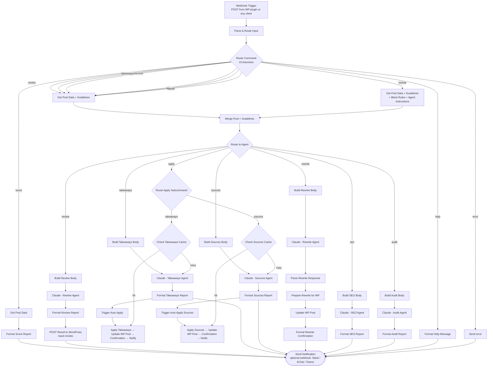

# n8n Workflow — Flow Diagram

The canonical workflow template ships with the plugin at
`post-quality-manager/templates/n8n-workflow.json` and is downloaded pre-configured
from **Settings → Workflow File**. Triggers are agnostic: the WordPress plugin
(dashboard button or WP-Cron) POSTs to the webhook; any chat tool or automation can
call the same contract. Results go back to the WordPress callback endpoint
(`/save-review`) and, optionally, to a notification webhook (Slack, kChat, Teams, …).

