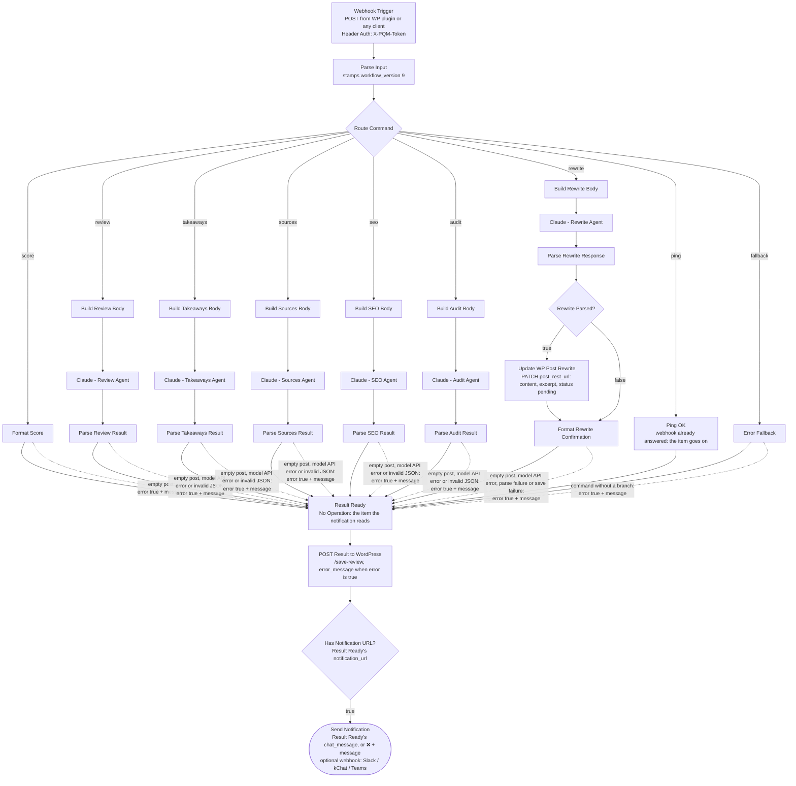

# n8n Workflow — Flow Diagram

The canonical workflow template ships with the plugin at
`post-quality-manager/templates/n8n-workflow.json` and is downloaded pre-configured
from the **Post Quality → n8n Workflow** page. Triggers are agnostic: the WordPress
plugin (dashboard button or WP-Cron) POSTs to the webhook; any chat tool or automation
can call the same contract. Results go back to the WordPress callback endpoint
(`/save-review`) and, optionally, to a notification webhook (Slack, kChat, Teams, …).

Contract details, by the workflow version that introduced them:

- **LLM request params ride the payload (v2).** The plugin sends a per-agent `llm` map
  (`model`, `max_tokens`, and — only where the chosen model supports them —
  `temperature`, `output_config.effort`, `thinking`). The "Build … Body" Code nodes
  spread that fragment into the Claude request as-is, so model/effort changes in
  WP settings apply on the next command without re-importing the workflow.
- **Version handshake (v2).** `Parse Input` stamps the template's `workflow_version` and
  the `/save-review` callback echoes it; the plugin flags an outdated import on the
  n8n Workflow page when the bundled template is newer.
- **Failures are reported, not hidden (v3).** The Claude and WordPress HTTP nodes
  "continue on error", so a failed call arrives as an item with `json.error`. The
  Parse nodes, `Format Score`, `Format Rewrite Confirmation` and `Error Fallback` turn
  each failure (empty post, model API error, unparseable agent output, failed rewrite
  save, command without a branch) into an item with `error: true` and a plain
  `message` naming what failed. `POST Result to WordPress` sends
  `error_message: $json.error ? ($json.message || 'The workflow could not complete this command. Check the execution log in n8n.') : ''`;
  the plugin stores a non-empty one as a review with status `error` and the kit shows
  "Could not complete". Boundary: only failures with a post and a command the plugin
  accepts reach `/save-review`. Parse Input rejections (missing `command`/`post_id`,
  or a command outside the `save-review` `command` enum) cannot be stored by contract
  and show only in the n8n execution log. `Rewrite Parsed?` keeps a failed rewrite
  away from `Update WP Post (Rewrite)`, so the post is never PATCHed (or unpublished
  to `pending`) when the agent's output could not be parsed.
- **Authenticated trigger, host-agnostic rewrite (v4).** One token, both directions:
  the plugin sends the webhook token as an `X-PQM-Token` header on every call (Run,
  cron, test ping), and the `Webhook Trigger` checks it with n8n Header Auth
  (credential `Post Quality webhook - <site host>`, header Name field `X-PQM-Token`,
  Value = the token; picked in the Webhook Trigger only — the Anthropic Header Auth
  credential goes in the six Claude nodes); n8n refuses a call without it (401/403) and
  no agent runs. The same header goes back on `/save-review`. Any other client must send
  the header too. The payload carries `post_rest_url` (the post's own REST address from
  `rest_url()`, right for any scheme, port, subdirectory install, permalink setting and
  REST-enabled post type), and `Update WP Post (Rewrite)` PATCHes it as-is — `''` when
  the post type is not in REST, so the node fails and the run reports "Could not save
  the rewrite". The rewrite still needs HTTPS (or a `local` environment type): the node
  signs in with an Application Password, which WordPress core offers only there. Known
  limitation: a v3 import ignores the header and the new field, so it keeps working
  but its trigger stays unauthenticated until you re-import.
- **The test ping reads the version (v5).** The Webhook Trigger answers on receipt with
  `{"ok":true,"workflow_version":9}` (its Response Data option, no extra node), so the
  plugin's test ping learns which workflow runs. An older import answers n8n's default
  body without a version, and the plugin reports it as an older version.
- **The test ping proves the way back (v7, story 2).** Parse Input's ping item carries
  `callback_url` (`…/post-quality/v1/ping/<id>`, a one-time id the plugin wrote before
  sending) and `auth_token`; `Ping OK` passes it on, and `POST Result to WordPress` calls
  the site back through the very node, header and timeout a review uses (`command: ping`,
  no `post_id`, score 0, empty result). The plugin waits up to 8 s for that call: received
  with the right token = the round trip works; a wrong token or no call = a failed test
  with the fix in its message. An older workflow still answers the ping without calling back.
- **The notification gets the result (v8, bug 97).** Every result node (`Format Score`,
  the five Parse … Result nodes, `Format Rewrite Confirmation`, `Error Fallback`,
  `Ping OK`) feeds `Result Ready`, a No Operation node, which feeds `POST Result to
  WordPress`. After the callback, `$json` is WordPress's `/save-review` reply, so
  `Has Notification URL?` and `Send Notification` read the address and the text from
  `$('Result Ready').first().json`; an item without `chat_message` (a Parse node's error,
  `Format Score`'s missing post) sends `'❌ ' + message`. The callback still continues on
  error, so a refused save still notifies. A v7 workflow saves results but never notifies.
- **Longer waits for Claude (v9, story 101).** The Claude nodes wait up to 120 s (Review),
  60 s (Takeaways, Sources, SEO) and 180 s (Audit, Rewrite) for the answer, so a model
  that thinks before it answers (Claude Opus 5.5) and long posts finish; the output
  budgets themselves ride the payload (`max_tokens`, v2). A v8 workflow keeps the
  older waits (Takeaways and Sources 30 s, Audit and Rewrite 120 s).

Solid edges are the connections in the template; dotted edges show the failure items
travelling the same connections into `/save-review` and the notification.

