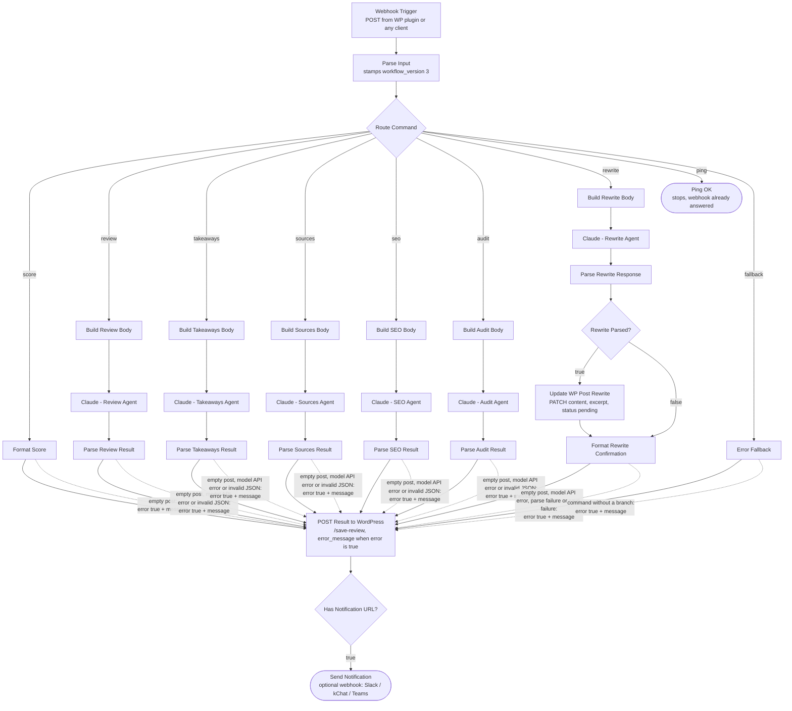

# n8n Workflow — Flow Diagram

The canonical workflow template ships with the plugin at
`post-quality-manager/templates/n8n-workflow.json` and is downloaded pre-configured
from the **Content Quality → n8n Workflow** page. Triggers are agnostic: the WordPress
plugin (dashboard button or WP-Cron) POSTs to the webhook; any chat tool or automation
can call the same contract. Results go back to the WordPress callback endpoint
(`/save-review`) and, optionally, to a notification webhook (Slack, kChat, Teams, …).

Contract details, by the workflow version that introduced them:

- **LLM request params ride the payload (v2).** The plugin sends a per-agent `llm` map
  (`model`, `max_tokens`, and — only where the chosen model supports them —
  `temperature`, `output_config.effort`, `thinking`). The "Build … Body" Code nodes
  spread that fragment into the Claude request as-is, so model/effort changes in
  WP settings apply on the next command without re-importing the workflow.
- **Version handshake (v2).** `Parse Input` stamps the template's `workflow_version` and
  the `/save-review` callback echoes it; the plugin flags an outdated import on the
  n8n Workflow page when the bundled template is newer.
- **Failures are reported, not hidden (v3).** The Claude and WordPress HTTP nodes
  "continue on error", so a failed call arrives as an item with `json.error`. The
  Parse nodes, `Format Score`, `Format Rewrite Confirmation` and `Error Fallback` turn
  each failure (empty post, model API error, unparseable agent output, failed rewrite
  save, command without a branch) into an item with `error: true` and a plain
  `message` naming what failed. `POST Result to WordPress` sends
  `error_message: $json.error ? ($json.message || 'The workflow could not complete this command. Check the execution log in n8n.') : ''`;
  the plugin stores a non-empty one as a review with status `error` and the kit shows
  "Could not complete". Boundary: only failures with a post and a command the plugin
  accepts reach `/save-review`. Parse Input rejections (missing `command`/`post_id`,
  or a command outside the `save-review` `command` enum) cannot be stored by contract
  and show only in the n8n execution log. `Rewrite Parsed?` keeps a failed rewrite
  away from `Update WP Post (Rewrite)`, so the post is never PATCHed (or unpublished
  to `pending`) when the agent's output could not be parsed.

Solid edges are the connections in the template; dotted edges show the failure items
travelling the same connection into `/save-review`.

