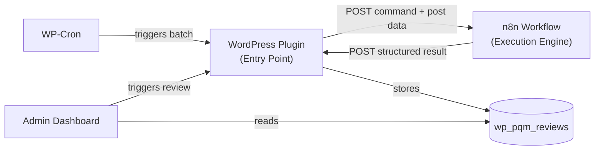
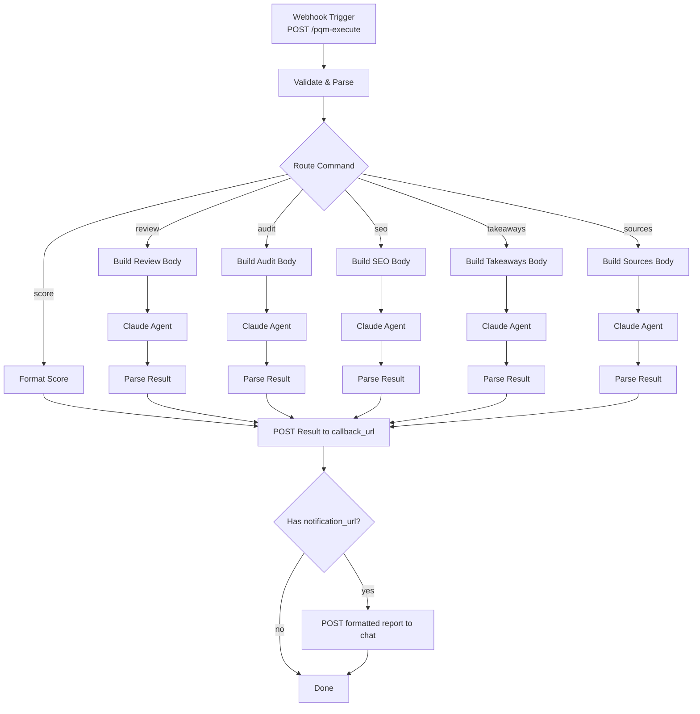

# Post Quality Manager — Implementation Plan v2

Transform the single-file REST endpoint into an **agnostic** content quality management plugin. The plugin is the **entry point** of the system — n8n is a generic execution engine.

## User Review Required

> [!IMPORTANT]
> **Agnostic design**: The plugin contains zero brand/site-specific code. All configuration (site URL, n8n webhook URL, notification webhook URL) lives in the Settings page. This means the same plugin works on any WordPress site with any thematic.

> [!IMPORTANT]
> **New n8n workflow**: A simplified, generic workflow replaces the current one. The workflow receives a structured payload from WordPress (post data + command + callback URL) and posts results back. Brand-specific prompts stay inside n8n (they are the site owner's workflow configuration, not a plugin concern).

> [!WARNING]
> **Breaking change**: The old [wordpress-plugin_post_quality_api.php](file:///c:/Git/n8n/Post%20Quality/wordpress-plugin_post_quality_api.php) must be deactivated before activating the new plugin. The REST namespace `post-quality/v1` is shared.

---

## System Architecture



**Flow for a review:**
1. User clicks "Review" on a post in the WP admin (or cron fires)
2. Plugin collects post data via its own REST endpoint, sends it to n8n webhook
3. n8n processes (Claude agent), then POSTs structured JSON result back to plugin's `/save-review` endpoint
4. Plugin stores result in custom DB table, visible in admin dashboard

---

## Plugin Structure

```
post-quality-manager/
├── post-quality-manager.php          ← Bootstrap, constants, hooks
├── uninstall.php                     ← Clean removal (drop table + options)
├── includes/
│   ├── class-pqm-activator.php       ← DB table creation via dbDelta()
│   ├── class-pqm-db.php              ← CRUD wrapper for reviews table
│   ├── class-pqm-rest-api.php        ← All REST endpoints
│   └── class-pqm-cron.php            ← WP-Cron scheduling
├── admin/
│   ├── class-pqm-admin.php           ← Admin pages (dashboard, posts, settings)
│   ├── css/pqm-admin.css             ← Admin styles
│   └── js/pqm-admin.js               ← Minimal JS (confirm dialogs, row expand)
└── README.md
```

---

## Proposed Changes

### Plugin Bootstrap

#### [NEW] [post-quality-manager.php](file:///c:/Git/n8n/Post%20Quality/post-quality-manager/post-quality-manager.php)

- Plugin header (Version 2.0.0, Text Domain: `post-quality-manager`)
- Constants: `PQM_VERSION`, `PQM_PLUGIN_DIR`, `PQM_PLUGIN_URL`
- Includes all class files
- Activation → `PQM_Activator::activate()`, Deactivation → `PQM_Cron::clear()`
- Hooks: `rest_api_init`, `admin_menu`, `admin_enqueue_scripts`, `pqm_cron_hook`

#### [NEW] [uninstall.php](file:///c:/Git/n8n/Post%20Quality/post-quality-manager/uninstall.php)

Drops `{prefix}_pqm_reviews` table, deletes `pqm_settings` option.

---

### Database Layer

#### [NEW] [class-pqm-activator.php](file:///c:/Git/n8n/Post%20Quality/post-quality-manager/includes/class-pqm-activator.php)

Table `{prefix}_pqm_reviews`:

| Column | Type | Notes |
|--------|------|-------|
| `id` | BIGINT PK | Auto-increment |
| `post_id` | BIGINT | WP post ID, indexed |
| `command` | VARCHAR(32) | `review`, `audit`, [score](file:///c:/Git/n8n/Post%20Quality/wordpress-plugin_post_quality_api.php#72-153), `seo`, `takeaways`, `sources` |
| `overall_score` | TINYINT | 0–100 |
| `status` | VARCHAR(20) | `ship` / `needs_revision` / `major_revision` |
| `result_data` | LONGTEXT | Full JSON from n8n |
| `reviewed_at` | DATETIME | When the review was performed |
| `created_at` | DATETIME | Row insertion time |

#### [NEW] [class-pqm-db.php](file:///c:/Git/n8n/Post%20Quality/post-quality-manager/includes/class-pqm-db.php)

CRUD methods:
- `save_review(post_id, command, score, status, result_json)` — INSERT
- `get_reviews_for_post(post_id)` — all reviews, newest first
- `get_latest_review(post_id, command)` — single most recent
- `get_all_posts_with_scores(args)` — paginated, sortable
- `get_posts_needing_review()` — no review OR old OR low score
- `get_dashboard_stats()` — aggregates for stat cards

---

### REST API

#### [NEW] [class-pqm-rest-api.php](file:///c:/Git/n8n/Post%20Quality/post-quality-manager/includes/class-pqm-rest-api.php)

| Endpoint | Method | Auth | Purpose |
|----------|--------|------|---------|
| `/post-quality/v1/post-score` | GET | `edit_posts` | **Existing** — post data + Yoast scores (no changes) |
| `/post-quality/v1/save-review` | POST | Token-based (pqm_webhook_token header) | n8n POSTs results here |
| `/post-quality/v1/reviews/{post_id}` | GET | `edit_posts` | Fetch stored reviews |
| `/post-quality/v1/trigger-review` | POST | `edit_posts` | **Plugin triggers n8n** — sends post data + command to n8n webhook |

**`save-review` incoming payload** (from n8n):
```json
{
  "post_id": 123,
  "command": "review",
  "overall_score": 78,
  "status": "ship",
  "result": { "structure": {"score": 80}, "readability": {"score": 75}, ... }
}
```

**`trigger-review` outgoing payload** (to n8n):
```json
{
  "callback_url": "https://yoursite.com/wp-json/post-quality/v1/save-review",
  "auth_token": "abc123",
  "command": "review",
  "post_id": 123,
  "slug": "my-post",
  "post_type": "post",
  "title": "My Post Title",
  "link": "https://yoursite.com/my-post/",
  "excerpt": "...",
  "content": "plain text...",
  "content_html": "raw Gutenberg HTML...",
  "seo_score": 75,
  "readability_score": 80,
  "focus_keyphrase": "...",
  "meta_description": "..."
}
```

> [!NOTE]
> The plugin sends **all post data** to n8n in the trigger payload. This means n8n no longer needs to call back WordPress to fetch the post — it gets everything in one request.

---

### Cron Jobs

#### [NEW] [class-pqm-cron.php](file:///c:/Git/n8n/Post%20Quality/post-quality-manager/includes/class-pqm-cron.php)

Configuration in `pqm_settings` option:
- `cron_enabled` (bool, default false)
- `cron_frequency` (`daily` / `weekly`)
- `cron_batch_size` (default 5)
- `cron_min_score` (re-review threshold, default 60)
- `cron_max_age_days` (re-review if older, default 30)

On fire: queries posts needing review → calls `trigger-review` for each → n8n processes → n8n POSTs back to `save-review`.

---

### Admin Dashboard

#### [NEW] [class-pqm-admin.php](file:///c:/Git/n8n/Post%20Quality/post-quality-manager/admin/class-pqm-admin.php)

Top-level menu **"Content Quality"** with 3 sub-pages:

**1. Dashboard** — Stat cards (total reviewed, avg score, needing revision, never reviewed) + status bar + last 10 reviews list

**2. Post Reviews** — WP_List_Table with columns: Title, Score (color badge), Status, Last Reviewed, Actions (View Detail, Trigger Review). Sortable/filterable.

**3. Settings** — n8n Webhook URL, Webhook Token (shared secret), optional Notification Webhook URL (kChat/Slack), Cron settings (enable, frequency, batch, thresholds). Uses Settings API.

#### [NEW] [pqm-admin.css](file:///c:/Git/n8n/Post%20Quality/post-quality-manager/admin/css/pqm-admin.css) + [pqm-admin.js](file:///c:/Git/n8n/Post%20Quality/post-quality-manager/admin/js/pqm-admin.js)

Native WP admin styling. Minimal JS for confirm dialogs and expandable detail rows.

---

## New n8n Workflow

#### [NEW] [n8n_post_quality_workflow_v2.json](file:///c:/Git/n8n/Post%20Quality/n8n_post_quality_workflow_v2.json)

Simplified architecture — the workflow becomes a **generic execution engine**:



**Key differences from current workflow:**

| Aspect | Old (v1) | New (v2) |
|--------|----------|----------|
| Trigger | kChat webhook (chat message) | Generic webhook (JSON from WP plugin) |
| Input parsing | Text command parsing (`review https://...`) | Pre-structured JSON with all post data |
| Post data fetch | n8n calls WP REST API | Already included in trigger payload |
| Guidelines fetch | n8n calls WP for private posts | Still fetched by n8n (brand-specific config) |
| Result output | kChat message only | POST to WP callback_url + optional notification |
| State/cache | In-memory workflow static data | Persistent in WP database |
| Apply commands | n8n patches WP posts | Kept in n8n (apply = write operation) |

**What stays in n8n (brand-specific):**
- Claude system prompts (editorial rules, brand voice)
- Writing guidelines fetch URL
- Apply commands (takeaways/sources/rewrite — these modify post content)
- kChat/notification formatting

**What moves to WordPress (agnostic):**
- Command routing entry point
- Result storage and history
- Review scheduling (cron)
- Dashboard and overview
- Post data collection

---

## Verification Plan

### Syntax Check
```bash
php -l post-quality-manager/*.php post-quality-manager/includes/*.php post-quality-manager/admin/*.php
```

### Manual Testing
1. Activate plugin → verify DB table created, admin menu appears
2. Configure settings → save n8n webhook URL and token → verify persistence
3. Go to Post Reviews → click "Trigger Review" on a post → verify n8n receives the request
4. Simulate n8n callback → POST to `/save-review` with test data → verify it appears in dashboard
5. Enable cron → verify event scheduled (WP Crontrol or `wp cron event list`)
6. End-to-end: trigger review from plugin → n8n processes → result posted back → visible in dashboard
